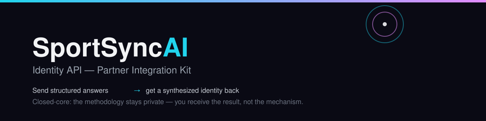
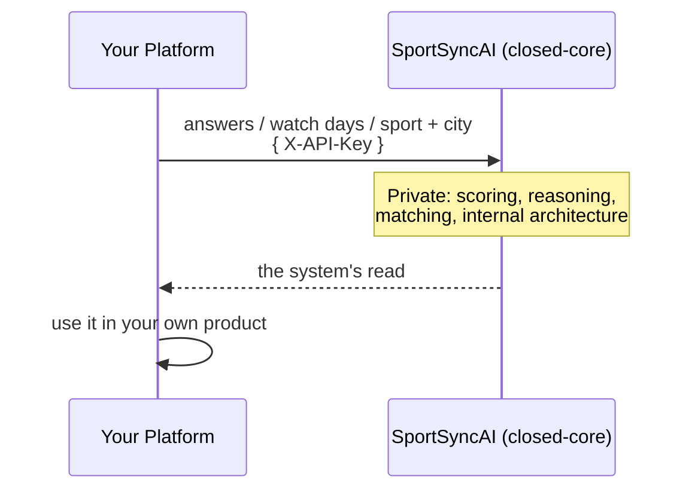

<p align="center">
  
</p>

<p align="center">
  <b>Hosted systems you call over HTTPS. You send your user's answers or watch data; the system sends back its read. You never get our code.</b>
</p>

<p align="center">
  <b>Full guide, in English and Arabic: <a href="https://sportsyncai.site/developers">sportsyncai.site/developers</a></b><br>
  Get an API key: <a href="https://sportsyncai.site/partner-onboarding.html">sportsyncai.site/partner-onboarding.html</a>
</p>

---

This is **public developer integration documentation** for SportSyncAI's partner API — not source code, and not an open-source release of SportSyncAI. **SportSyncAI's core implementation and intelligence remain proprietary.** What's here is everything a developer needs to integrate against the live HTTPS API: the contract, a runnable example, and nothing else.

**New to this?** Start with **[What the Identity API enables](docs/WHAT_IT_ENABLES.md)** — what it does for your product, what you're not taking on, and where its limits honestly are. Then come back here for the integration.

## The systems

Each row is one hosted system. This page names what each one takes in and what kind of answer it gives — the full contract is in [docs/API_REFERENCE.md](docs/API_REFERENCE.md).

| System | Endpoint | You send | You get back |
|---|---|---|---|
| Question catalog | `GET /api/v1/integrate/questions` | nothing (no key needed) | the questions and option text to ask your users |
| Identity | `POST /api/v1/integrate/identity` | the user's answers | a category, an identity name and a short narrative |
| Body reading | `POST /api/v1/integrate/body-reading` | up to 14 days of the user's watch data | how the user lives, in words, how sure the read is, and where the body disagrees with the answers |
| Sport map | `POST /api/v1/integrate/sport-map` | answers and/or watch days | up to three sports, one per world, that run on the same drivers — a map, not a ranking |
| Places | `GET /api/v1/integrate/places` | a sport and a city | real venues and groups for that sport in that city, without contact details |
| People | `PUT /api/v1/integrate/people/{user_id}` · `GET …/matches` · `POST …/block/{other_id}` | the user's profile and consent to be matched | other users **of yours**, same gender only, who play alike |
| Delete a user | `DELETE /api/v1/integrate/users/{user_id}` | a user id | everything stored for that user is erased |
| Usage | `GET /api/v1/integrate/usage` | a month | your successful calls per system for that month |



Everything inside the "SportSyncAI" box is private. Everything crossing the arrows is the whole integration surface.

**How you pay:** per successful call (HTTP 200), per system. Errors are not counted. `usage` and `delete` are free. Prices are agreed per partner.

**What we keep:** when you send a `user_id`, we keep that user's answers and watch days under your account (up to 365 days) so each read builds on the last. One `DELETE` erases all of it. Send only users who agreed to this in your own terms.

## Quickstart — run the real example, on any device

You need Docker and one API key (see [Getting a key](#getting-a-key)). Nothing else — no Python, no Node, no local setup.

```bash
cd examples
docker build -t sportsyncai-example .
docker run --rm -e SPORTSYNCAI_API_KEY=<your key> sportsyncai-example
```

That's it. The container calls the real, live, hosted API — the question catalog and the identity system — and prints whatever the system answers for that one sample answer.


### Without Docker

If you'd rather run it directly (only needs Python 3, no dependencies beyond the standard library):

```bash
SPORTSYNCAI_API_KEY=<your key> python3 examples/example.py
```

## What's in this repository

| Path | Purpose |
|---|---|
| `docs/WHAT_IT_ENABLES.md` | What integrating these systems does for your business, what you don't have to build, and what they deliberately don't do. |
| `docs/API_REFERENCE.md` | The complete contract — every field, every error code, request-size limits, rate limits. |
| `docs/ROADMAP.md` | What is live and what is still a direction. |
| `examples/example.py` | The identity integration in ~50 lines. Calls the catalog and identity systems over HTTPS. Read it end to end; it's short on purpose. |
| `examples/Dockerfile` | Wraps `example.py` so it runs identically on any OS with zero local setup. |
| `assets/banner.svg` | This page's banner. |

## Getting a key

API keys are issued individually. **Request one through the [onboarding form](https://sportsyncai.site/partner-onboarding.html)**, or email [partners@sportsyncai.site](mailto:partners@sportsyncai.site). We review every request and send you a key that starts with `ssai_`.

You can check the API is live before you have a key: open [the question list](https://sportsyncai.site/api/v1/integrate/questions) in your browser. It returns `"success": true` and every question.

Send the key in the `X-API-Key` header; it identifies your integration, not a person, and is separate from any SportSyncAI end-user login.

## What you will never receive

Code of any kind, per-answer scoring weights, the internal reasoning taxonomy, trait numbers, any trace of the reasoning process, internal record identifiers, other partners' users, our own users, venue contact details, or anything about SportSyncAI's architecture. Each system's answer is the complete, final answer.

## Licensing

No open-source license is granted. This repository is public developer documentation and integration examples; SportSyncAI's implementation and intelligence remain proprietary. The example code here is provided for building an integration against the documented API. Questions: [partners@sportsyncai.site](mailto:partners@sportsyncai.site).
